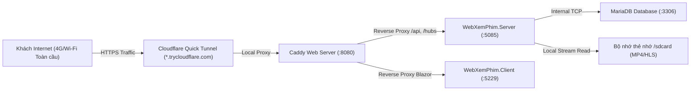

# 🎬 CinemaFlow (WebXemPhim) - Nền Tảng Xem Phim Trực Tuyến Hiện Đại

[](https://dotnet.microsoft.com/)
[](https://dotnet.microsoft.com/apps/aspnet/web-apps/blazor)
[](https://www.postgresql.org/)
[](https://caddyserver.com/)
[](https://www.cloudflare.com/)
[-brightgreen?logo=xunit&logoColor=white)](tests/)
[](LICENSE)

**CinemaFlow (WebXemPhim)** là nền tảng streaming phim trực tuyến thế hệ mới, được kiến trúc hóa theo mô hình phân tách độc lập giữa **Server (ASP.NET Core Web API)** và **Client (Blazor Web App)** hoàn toàn bằng ngôn ngữ C# (.NET 10). 

Hệ thống được thiết kế theo chuẩn thẩm mỹ điện ảnh cao cấp (**Cinema-grade Obsidian Palette**), tích hợp công nghệ phân phối luồng phát video bảo mật đa lớp (**Signed URLs, Concurrency Eviction, Anti-Hotlinking**), giao diện tối ưu hóa cảm ứng di động (**Mobile-First Bottom Dock**) và hỗ trợ triển khai linh hoạt từ máy chủ Cloud (VPS Docker) đến thiết bị di động cá nhân (biến điện thoại Android thành server phát Internet toàn cầu).

---

## 📑 Mục Lục
1. [🌟 Tính Năng Nổi Bật](#-tính-năng-nổi-bật)
   - [Trải Nghiệm Xem Phim & Client](#1-trải-nghiệm-xem-phim--client)
   - [Tối Ưu Hóa Di Động (Mobile-First Experience)](#2-tối-ưu-hóa-di-động-mobile-first-experience)
   - [Động Cơ Bảo Mật Luồng Phát (Stream Security Engine)](#3-động-cơ-bảo-mật-luồng-phát-stream-security-engine)
   - [Trung Tâm Điều Hành Quản Trị (Admin Cockpit & Telemetry)](#4-trung-tâm-điều-hành-quản-trị-admin-cockpit--telemetry)
2. [🏗️ Kiến Trúc Hệ Thống (Architecture)](#️-kiến-trúc-hệ-thống-architecture)
3. [💻 Yêu Cầu Môi Trường (Prerequisites)](#-yêu-cầu-môi-trường-prerequisites)
4. [🚀 Hướng Dẫn Cài Đặt & Chạy Cục Bộ (Local Development)](#-hướng-dẫn-cài-đặt--chạy-cục-bộ-local-development)
5. [📱 Triển Khai Máy Chủ Trên Điện Thoại Android (Phone Host)](#-triển-khai-máy-chủ-trên-điện-thoại-android-phone-host)
6. [🐳 Triển Khai Docker VPS & CI/CD (Production Deployment)](#-triển-khai-docker-vps--cicd-production-deployment)
7. [🧪 Kiểm Thử Tự Động (1,351 Tests 100% PASS)](#-kiểm-thử-tự-động-1351-tests-100-pass)
8. [🔑 Danh Sách Tài Khoản Thử Nghiệm (Seed Accounts)](#-danh-sách-tài-khoản-thử-nghiệm-seed-accounts)
9. [📐 Quy Chuẩn Lập Trình & Thiết Kế (Standards & Discipline)](#-quy-chuẩn-lập-trình--thiết-kế-standards--discipline)

---

## 🌟 Tính Năng Nổi Bật

### 1. Trải Nghiệm Xem Phim & Client
- **Trình phát video điện ảnh (`CinemaPlayer`)**:
  - Hỗ trợ phát video định dạng chất lượng cao (4K UHD, Full HD 1080p, 720p) với chuẩn mã hóa H.264 / AAC và HLS adaptive streaming.
  - Hỗ trợ cơ chế **HTTP 206 Partial Content Range**: Tua nhanh tức thì đến bất kỳ giây nào mà không cần tải trước toàn bộ tệp video.
  - Phím tắt điều khiển trực quan: Space (Play/Pause), Mũi tên trái/phải (Tua lùi/tiến 10s), M (Mute), F (Fullscreen).
  - Chế độ rạp chiếu phim (**Lights Off**): Tối mờ toàn bộ giao diện xung quanh để tập trung trọn vẹn vào nội dung.
  - Tính năng **Tự động chuyển tập (Auto-Next)** và lưu lịch sử tiến trình xem (Resume Playback).
- **Thanh công cụ nguồn phát tối giản (`Minimalist Stream Selector`)**:
  - Giao diện siêu gọn (chiều cao <= 38px, nút <= 28px) hiển thị thời gian phản hồi máy chủ (Ping ms) theo thời gian thực.
  - Cho phép người xem chuyển đổi mượt mà giữa các máy chủ CDN (Server 1, Server 2, Backup CDN) khi đường truyền mạng có sự cố.
- **Phân vùng Bento Box nghệ thuật (`Genre Bento Grid`)**:
  - Danh mục thể loại phim được thiết kế dạng lưới Bento bất đối xứng, phối hợp ảnh nền điện ảnh cùng hiệu ứng ánh sáng viền mềm mại.
- **Khám phá & Tìm kiếm thông minh**:
  - Tìm kiếm toàn văn tiếng Việt không dấu siêu tốc nhờ **PostgreSQL Full-Text Search (GIN Index)**.
  - Bộ lọc đa chiều: Thể loại, quốc gia, năm phát hành, định dạng (Phim lẻ, Phim bộ, Anime), sắp xếp theo điểm IMDb hoặc lượt xem.
- **Tủ phim & Thành viên VIP**:
  - Quản lý danh sách phim theo dõi (Watchlist) với cập nhật huy hiệu số lượng thời gian thực.
  - Gói đăng ký hội viên VIP (Silver, Gold, Platinum, Diamond) mở khóa các tác phẩm điện ảnh 4K độc quyền.
- **Hệ thống tương phản kép (Dual-Theme Contrast)**:
  - **Dark Mode**: Gam màu Obsidian `#07080a` / `#12141a` huyền bí, viền mờ `rgba(255,255,255,0.08)`.
  - **Light Mode**: Nền trắng sáng dập nổi `#cbd5e1`, văn bản tương phản cao `#0f172a`, công tắc xúc giác (Tactile switches) rực rỡ, không gây mỏi mắt.

### 2. Tối Ưu Hóa Di Động (Mobile-First Experience)
- **Thanh điều hướng đáy tiện dụng (Sticky Mobile Bottom Nav Dock)**:
  - Cố định ở đáy màn hình di động (màn hình <= 768px), thiết kế chuẩn công thái học vùng ngón tay cái (**Thumb-Friendly Zone**).
  - 5 phân vùng truy cập 1-chạm: **Trang chủ**, **Khám phá**, **Thể loại**, **Tủ phim** (có huy hiệu số lượng), **Tài khoản** (kèm avatar ký tự đầu và biểu tượng vương miện VIP).
  - Tự động ẩn hoàn toàn khi người dùng vào trang xem phim (`/watch`) để tối đa hóa không gian phát video.
  - Tích hợp chuẩn đệm an toàn `env(safe-area-inset-bottom)` cho iPhone tai thỏ và các máy Android viền cong.
- **Lưới số tập phim phản hồi nhanh (Quick Episode Grid)**:
  - Hỗ trợ chuyển đổi linh hoạt giữa dạng danh sách chi tiết (List view) và dạng ô số gọn gàng (Grid view 44px x 44px), giúp duyệt phim bộ 24+ tập nhanh chóng mà không phải cuộn trang dài.
- **Chuẩn cảm ứng tối thiểu (Tap Targets >= 44px)**:
  - Tất cả các nút bấm, biểu tượng tìm kiếm, nút lọc và phím điều khiển đều đạt kích thước tối thiểu 44px x 44px, loại bỏ hiện tượng bấm nhầm trên màn hình cảm ứng.
- **Cuộn gia tốc không rung lắc (Zero Horizontal Shake)**:
  - Áp dụng `-webkit-overflow-scrolling: touch` trên các dải phim trượt ngang (`.home-movie-rail`, `.tonight-picks-grid`), khóa tràn khung `overflow-x: hidden` giữ giao diện vững chãi.

### 3. Động Cơ Bảo Mật Luồng Phát (Stream Security Engine)
- **Chữ ký URL mật mã (Cryptographic Signed URLs)**:
  - Mọi luồng stream video đều được ký bằng thuật toán **HMAC-SHA256** với khóa bí mật tối thiểu 32 ký tự.
  - Tham số chữ ký tự động hết hạn (`expires`), ngăn chặn hành vi copy link sang trình duyệt khác hoặc nhúng lậu (Anti-hotlinking).
- **Khóa IP linh hoạt (IP Binding & Loopback Lease Fallback)**:
  - Chữ ký liên kết chặt chẽ với địa chỉ IP của thiết bị được cấp quyền.
  - Tích hợp cơ chế thông minh nhận diện kết nối vòng lặp nội bộ (Loopback Lease) giữa Blazor Server WebSocket circuit và trình duyệt ngoài, giải quyết triệt để lỗi lệch IP khi đi qua Cloudflare Tunnel hoặc Reverse Proxy Caddy.
- **Kiểm soát phiên đồng thời & Cảnh báo Kick (Concurrency Kick UX)**:
  - Giới hạn 1 thiết bị phát video hoạt động đồng thời trên mỗi tài khoản.
  - Khi phát hiện tài khoản đăng nhập xem phim ở nơi khác, hệ thống sẽ kích hoạt hộp thoại **Eviction Modal** thông báo chi tiết thời gian và tự động tạm dừng phát video trên phiên cũ.
- **Hệ thống bảo vệ tải (Rate Limiting & Circuit Breaker)**:
  - Giới hạn tần suất gọi API đăng nhập, đăng ký và ký luồng phát theo thuật toán Token Bucket (IP-based).
  - Bảo vệ máy chủ chống tấn công Brute-force và cạn kiệt tài nguyên mạng.

### 4. Trung Tâm Điều Hành Quản Trị (Admin Cockpit & Telemetry)
- **Giám sát truyền dẫn thời gian thực (`/admin/telemetry`)**:
  - Thu thập và trực quan hóa các chỉ số phát video: Độ trễ mạng (Ping ms), số lần đệm (Buffer stall count), tốc độ truyền tải trung bình (Bitrate), trạng thái hoạt động của từng node máy chủ phát.
- **Quản lý danh mục kho phim (`/admin/movies`)**:
  - Bộ lọc 7 chiều (thể loại, định dạng, chất lượng 4K/FHD, cờ thịnh hành, năm, IMDb, từ khóa).
  - Tự động xóa bộ nhớ đệm OutputCache ngay khi danh mục phim được cập nhật.
- **Quản lý tập phim & CDN (`/admin/episodes`)**:
  - Tạo và cập nhật tập phim linh hoạt, tải lên hình ảnh thumbnail tập phim, cấu hình luồng phát đa nguồn CDN.
- **Quản lý người dùng (`/admin/users`)**:
  - Thống kê người dùng theo cấp bậc (Thường / VIP), quản lý trạng thái khóa/mở tài khoản, cấp phát thời hạn VIP.
- **Nhật ký kiểm toán an toàn (`/admin/audit-logs`)**:
  - Ghi nhận chi tiết mọi hành vi quản trị, thay đổi cấu hình, tạo tập phim hoặc các cảnh báo bảo mật.

---

## 🏗️ Kiến Trúc Hệ Thống (Architecture)

```
WebXemPhim Solution
├── src/
│   ├── Server/
│   │   └── WebXemPhim.Server/     # ASP.NET Core REST API (.NET 10)
│   │       ├── Controllers/       # Movies, Episodes, Stream, Auth, Telemetry, Admin Controllers
│   │       ├── Data/              # EF Core AppDbContext, DatabaseSeeder, Migrations (PostgreSQL/MySQL)
│   │       ├── Hubs/              # SignalR CinemaHub (Real-time alerts, playback synchronization)
│   │       └── Security/          # StreamUrlSigner, Rate Limiting, PublicUrlResolver, HLS Rewriter
│   │
│   ├── Client/
│   │   └── WebXemPhim.Client/     # Blazor Interactive Server Web App (.NET 10)
│   │       ├── Components/        # Layout, Pages (Home, Watch, Explore, Genres, Watchlist, Admin)
│   │       │   ├── Layout/        # MainLayout, NavMenu, MobileBottomNav, AdminSidebar
│   │       │   ├── Player/        # CinemaPlayer, WatchDiscussion, StreamSelector
│   │       │   └── Icons/         # CinemaIcon (Bộ icon SVG native siêu nhẹ)
│   │       ├── Services/          # ApiClients, AuthState, WatchlistState, ThemeState, CircuitClientIp
│   │       └── wwwroot/           # CSS Cinema-grade, JS Player/Theme scripts, Phông chữ Be Vietnam Pro
│   │
│   └── Shared/
│       └── WebXemPhim.Shared/     # Thư viện dùng chung giữa Server & Client
│           ├── Models/            # DTOs (MovieDto, EpisodeDto, SignedStreamDto, TelemetryDto)
│           ├── Enums/             # MovieType, MembershipTier, ReportReason, AuditAction
│           ├── Requests/          # LoginRequest, RegisterRequest, PlaybackTelemetryRequest
│           └── Security/          # WebSecurityExtensions (Production validation rules)
│
├── database/
│   ├── postgresql/                # 001_initial.sql (Schema, Trigger chuẩn hóa, GIN Full-Text Index)
│   └── mysql/                     # Scripts khởi tạo MariaDB/MySQL cho thiết bị nhúng
├── deploy/                        # Caddyfile, Dockerfile.server, Dockerfile.client, compose specs
├── docs/                          # Tài liệu kiến trúc, bảo mật stream, deployment, audit di động
├── scripts/                       # Shell scripts chạy daemon, setup Android Termux, Quick Tunnel
├── tests/
│   └── WebXemPhim.Tests/          # 1,351 Unit & Integration Testcases (Testcontainers PostgreSQL)
└── WebXemPhim.slnx                # Solution định dạng mới của .NET 10
```

---

## 💻 Yêu Cầu Môi Trường (Prerequisites)

- **Hệ điều hành**: Windows 10/11, macOS hoặc Linux (Ubuntu 22.04+).
- **Bộ công cụ phát triển**: [.NET 10 SDK](https://dotnet.microsoft.com/download) (kiểm tra bằng lệnh `dotnet --version`).
- **Cơ sở dữ liệu**:
  - **Khuyến nghị**: [PostgreSQL 17](https://www.postgresql.org/) (hoặc chạy nhanh qua Docker).
  - **Tùy chọn nhẹ**: MariaDB 10.6+ hoặc MySQL 8.0+.
- **Docker Desktop** (tùy chọn - dùng khi chạy kiểm thử tích hợp Testcontainers hoặc đóng gói container).

---

## 🚀 Hướng Dẫn Cài Đặt & Chạy Cục Bộ (Local Development)

### Bước 1: Sao chép mã nguồn
```bash
git clone https://github.com/kynhungvanlaky-max/w-xemphim.git
cd w-xemphim
```

### Bước 2: Thiết lập cấu hình môi trường
Sao chép file cấu hình mẫu cho môi trường Development:
```powershell
# Trên Windows PowerShell
copy src\Server\WebXemPhim.Server\appsettings.Development.example.json src\Server\WebXemPhim.Server\appsettings.Development.json
copy src\Client\WebXemPhim.Client\appsettings.Development.example.json src\Client\WebXemPhim.Client\appsettings.Development.json
```
```bash
# Trên Linux / macOS Bash
cp src/Server/WebXemPhim.Server/appsettings.Development.example.json src/Server/WebXemPhim.Server/appsettings.Development.json
cp src/Client/WebXemPhim.Client/appsettings.Development.example.json src/Client/WebXemPhim.Client/appsettings.Development.json
```

*(Mặc định kết nối CSDL sử dụng `Host=127.0.0.1;Port=5432;Database=webxemphim;Username=webxemphim;Password=webxemphim;`)*

### Bước 3: Khởi động cơ sở dữ liệu PostgreSQL (qua Docker)
```bash
docker run --name cinema-postgres -e POSTGRES_DB=webxemphim -e POSTGRES_USER=webxemphim -e POSTGRES_PASSWORD=webxemphim -p 5432:5432 -d postgres:17-alpine
```

### Bước 4: Khởi chạy Server Web API
```bash
dotnet run --project src/Server/WebXemPhim.Server/WebXemPhim.Server.csproj --launch-profile http
```
- **Địa chỉ API**: `http://localhost:5085`
- **Tài liệu OpenAPI / Swagger**: `http://localhost:5085/openapi/v1.json`
- *Cơ chế DatabaseSeeder sẽ tự động nạp danh mục phim mẫu và các tài khoản demo khi khởi động lần đầu.*

### Bước 5: Khởi chạy Client Blazor Web App (Terminal khác)
```bash
dotnet run --project src/Client/WebXemPhim.Client/WebXemPhim.Client.csproj --launch-profile http
```
- **Mở trình duyệt xem phim**: `http://localhost:5229`

*(Gợi ý: Trên Windows, bạn có thể nhấp đúp vào `run-app.bat` để tự động bật cả Server và Client, và dùng `stop-app.bat` để tắt hệ thống).*

---

## 📱 Triển Khai Máy Chủ Trên Điện Thoại Android (Phone Host)

CinemaFlow sở hữu kiến trúc cực kỳ tối ưu, cho phép **biến trực tiếp một chiếc điện thoại Android phổ thông (như Samsung Galaxy A05, Xiaomi, Pixel...) thành máy chủ phát phim trực tuyến toàn cầu ra Internet** mà không cần mở port modem hay mua IP tĩnh.



### Cách bước thiết lập máy chủ trên Android:
1. **Cài đặt Termux** từ F-Droid hoặc GitHub.
2. Mở Termux và cài đặt môi trường Ubuntu qua `proot-distro`:
   ```bash
   pkg update -y && pkg install -y proot-distro git curl wget
   proot-distro install ubuntu
   ```
3. Kết nối máy tính với điện thoại qua cáp USB và mở chế độ USB Debugging (ADB).
4. Đẩy tệp tự động hóa và các bản build ARM64 lên điện thoại:
   ```powershell
   dotnet publish src/Server/WebXemPhim.Server/WebXemPhim.Server.csproj -c Release -r linux-arm64 --no-self-contained -o ./publish-arm64/server
   dotnet publish src/Client/WebXemPhim.Client/WebXemPhim.Client.csproj -c Release -r linux-arm64 --no-self-contained -o ./publish-arm64/client
   
   adb push scripts/phone_daemon.sh /sdcard/phone_daemon.sh
   adb push publish-arm64/server/WebXemPhim.Server.dll /sdcard/WebXemPhim.Server.dll
   adb push publish-arm64/client/WebXemPhim.Client.dll /sdcard/WebXemPhim.Client.dll
   adb push publish-arm64/client/wwwroot /sdcard/client_wwwroot
   ```
5. Trong Termux trên điện thoại, chạy lệnh kích hoạt dịch vụ:
   ```bash
   bash /sdcard/phone_daemon.sh
   ```
6. Hệ thống sẽ:
   - Tự động bật MariaDB nội bộ và cấp khóa bảo vệ DataProtection.
   - Bật Server Web API (port 5085) và Client Blazor (port 5229).
   - Bật Caddy Reverse Proxy (port 8080).
   - Tự động cấp đường hầm **Cloudflare Quick Tunnel** bảo mật HTTPS toàn cầu dạng:
     👉 `https://xxxx-xxxx-xxxx.trycloudflare.com`
   - Bạn có thể gửi đường link này cho bạn bè ở bất kỳ đâu trên thế giới để cùng truy cập và xem phim mượt mà.

---

## 🐳 Triển Khai Docker VPS & CI/CD (Production Deployment)

Dự án đi kèm bộ tệp cấu hình triển khai hoàn chỉnh cho môi trường Production trên VPS Linux (Ubuntu / Debian):

### 1. Cấu trúc Triển Khai Docker Compose
- `docker-compose.prod.yml`: Điều phối 4 container gồm `caddy`, `server`, `client`, và `db` (PostgreSQL 17).
- Caddy tự động đăng ký và gia hạn chứng chỉ SSL Let's Encrypt / ZeroSSL miễn phí khi trỏ tên miền thật.

### 2. Triển khai nhanh trên VPS
```bash
# 1. Đặt các biến môi trường cần thiết
export DOMAIN="phim.yourdomain.com"
export DB_PASSWORD="YourStrongSecurePasswordHere123!"
export STREAM_SIGNING_KEY="YourAtLeast32BytesLongSecretSigningKeyHere!"

# 2. Khởi chạy toàn bộ hệ thống
docker compose -f docker-compose.prod.yml up -d --build
```
Xem hướng dẫn chi tiết từng bước thiết lập SSH, cấu hình tường lửa UFW và CI/CD GitHub Actions tại:
👉 [docs/vps-deployment-guide.md](docs/vps-deployment-guide.md).

---

## 🧪 Kiểm Thử Tự Động (1,351 Tests 100% PASS)

Toàn bộ logic nghiệp vụ, bảo mật luồng phát, chữ ký URL, cơ chế chống tấn công giả mạo (tampering), thuật toán giới hạn tần suất (rate limiting) và tích hợp cơ sở dữ liệu thực tế đều được bảo vệ nghiêm ngặt bởi bộ kiểm thử tự động toàn diện:

```bash
dotnet test WebXemPhim.slnx
```

### Kết quả chạy kiểm thử:
```text
Passed!  - Failed: 0, Passed: 1351, Skipped: 0, Total: 1351, Duration: 3 m 36 s
WebXemPhim.Tests.dll (.NETCoreApp,Version=v10.0)
```

### Các nhóm kiểm thử trọng yếu:
1. **Relational Database & Full-Text Search**: Kiểm thử trên instance PostgreSQL thật qua Testcontainers, kiểm tra trigger tự động sinh vector tiếng Việt và chỉ mục GIN.
2. **Stream Security & IP Binding**: Kiểm tra chữ ký HMAC, phát hiện token giả mạo, kiểm tra thời gian hết hạn (expiration) và cơ chế khóa IP.
3. **Concurrency Control**: Mô phỏng hàng trăm request đồng thời kiểm tra hàm đếm view nguyên tử (`AtomicViewCounter`) không làm mất dữ liệu.
4. **Session Eviction**: Kiểm tra đá phiên phát khi tài khoản phát video đồng thời trên 2 thiết bị khác nhau.
5. **Rate Limiting**: Bắn burst traffic kiểm tra mã lỗi HTTP 429 Too Many Requests.

---

## 🔑 Danh Sách Tài Khoản Thử Nghiệm (Seed Accounts)

Cơ sở dữ liệu mẫu được nạp sẵn các tài khoản thử nghiệm với đầy đủ các quyền hạn:

| Vai trò / Phân quyền | Email đăng nhập | Tên đăng nhập phụ | Mật khẩu | Quyền lợi & Mô tả |
| :--- | :--- | :--- | :--- | :--- |
| **Quản trị viên (Admin)** | `admin@cinemaflow.vn` | `admin` | `Password123!` | Toàn quyền truy cập Admin Workspace (`/admin`), quản lý kho phim, telemetry, audit logs. |
| **Hội viên VIP (Demo)** | `demo@cinemaflow.vn` | `demo` | `Password123!` | Sở hữu gói VIP 1 năm, xem phim 4K không giới hạn, không có quảng cáo. |
| **Hội viên VIP (Mẫu)** | `vip@cinemaflow.vn` | `vip` | `Password123!` | Tài khoản hội viên VIP tiêu chuẩn. |
| **Người dùng thông thường** | `thuylinh@cinemaflow.vn` | `thuylinh` | `Password123!` | Tài khoản xem phim miễn phí (Full HD). |
| **Người dùng thông thường** | `longle@cinemaflow.vn` | `longle` | `Password123!` | Tài khoản người dùng cơ bản. |

---

## 📐 Quy Chuẩn Lập Trình & Thiết Kế (Standards & Discipline)

Dự án tuân thủ nghiêm ngặt các quy tắc kỹ thuật trong [`AGENTS.md`](AGENTS.md):

1. **Testing First**: Bất kỳ sự thay đổi code logic nào cũng phải đảm bảo 100% testcases đều PASS.
2. **Build Check 100% 0 Errors**: Toàn bộ Solution phải biên dịch thành công (`dotnet build WebXemPhim.slnx`) với 0 Warning và 0 Error trước khi kết thúc bất kỳ phiên làm việc nào.
3. **Kiến Trúc Tách Biệt C# Only**: Client và Server giao tiếp hoàn toàn qua chuẩn REST API và SignalR, tuyệt đối không gọi chéo CSDL trực tiếp từ Client.
4. **Chuẩn Thẩm Mỹ Điện Ảnh (`taste-skill`)**:
   - `DESIGN_VARIANCE: 7`, `MOTION_INTENSITY: 6`, `VISUAL_DENSITY: 5`.
   - Bảng màu Obsidian, chi tiết viền tinh tế, skeleton loading, không sử dụng AI-slop gradients hay spinner tròn lỗi thời.
5. **Kỷ Luật Căn Lề Khung Chứa (`Container Alignment Discipline`)**:
   - Tất cả các section trên cùng một trang phải nằm trọn trong một khung bọc container duy nhất, căn thẳng hàng pixel-perfect (100%) với các mép lề.
6. **Thanh Tiện Ích Tối Giản (`Minimalist Utility Toolbar`)**:
   - Các thanh điều khiển phụ trợ (như thanh chọn nguồn phát phim, thanh công cụ video, filter bar) thiết kế siêu gọn nhẹ (chiều cao <= 38px, chiều cao nút <= 28px).
7. **Đồng Bộ Tương Phản Hai Giao Diện (`Dual-Theme Contrast`)**:
   - Đảm bảo độ rõ nét, tương phản cao trên cả Dark Mode và Light Mode, loại trừ hoàn toàn hiện tượng chữ mờ hoặc chìm viền.

---

## 📄 Giấy Phép & Bản Quyền (License)

Dự án được phân phối dưới giấy phép mã nguồn mở **MIT License**. Mọi chi tiết xin liên hệ repository chính thức tại:  
👉 [GitHub Repository: kynhungvanlaky-max/w-xemphim](https://github.com/kynhungvanlaky-max/w-xemphim)
